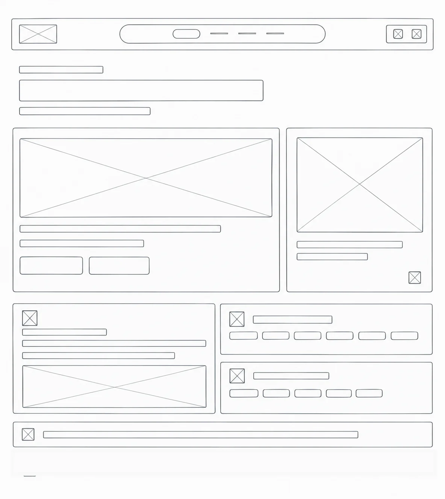
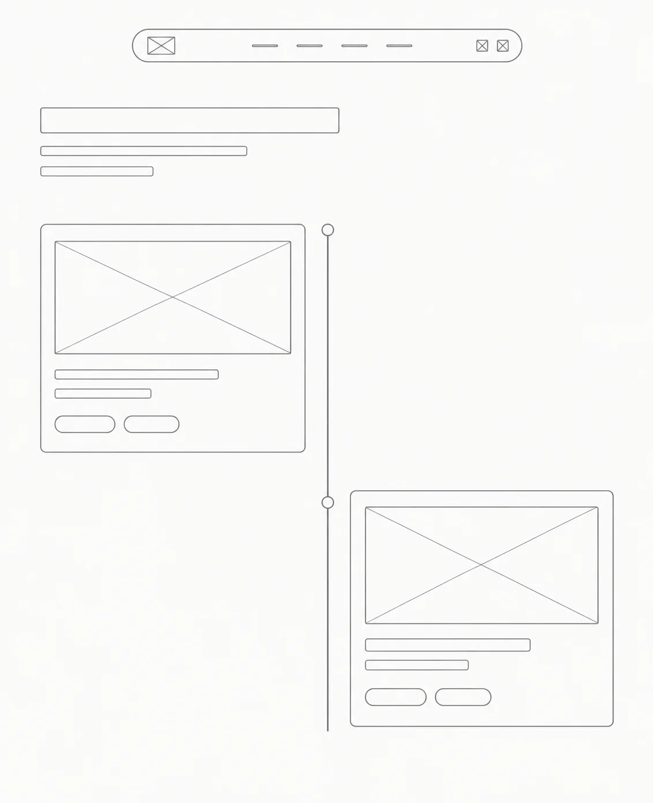
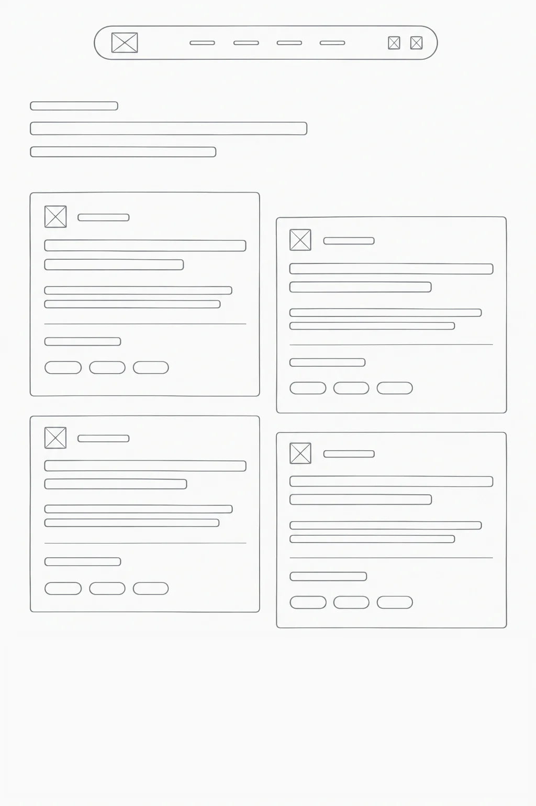
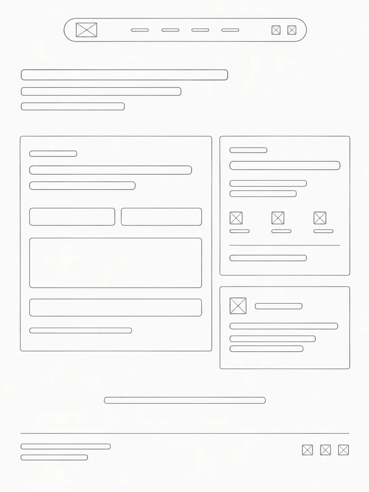

# 🌌 Portfólio Profissional

🚧 **Status:** em desenvolvimento...

---

## 📝 Sobre o Projeto

Este é o repositório do meu portfólio profissional, com o objetivo de apresentar minha trajetória, habilidades, projetos e curiosidades sobre mim, tudo de forma responsiva e acessível.

---

## ✨ Funcionalidades

- 👤 **Sobre Mim:** apresentação em português e inglês (alternância PT | EN), com formação, área de atuação, interesses e objetivos.
- 🗂️ **Projetos:** linha do tempo (do mais antigo ao mais recente), com nome, descrição, tecnologias, link do GitHub e imagem do projeto em funcionamento.
- 💼 **Experiências:** empresa/instituição, cargo ou atividade, período e breve descrição.
- ✉️ **Contato:** ícones clicáveis (e-mail, WhatsApp, LinkedIn) e formulário com envio de e-mail.
- 📱 **Design responsivo** para desktop e mobile.

---

## 🎨 Protótipos

Wireframes criados no Figma.

### Sobre Mim


### Projetos


### Experiências


### Contato


---

## 🛠 Tecnologias Previstas

- **React** — biblioteca para construção da interface
- **Vite** — build tool e servidor de desenvolvimento
- **Tailwind CSS** — estilização utilitária
- **Framer Motion** — animações
- **EmailJS** — envio de e-mail direto do front-end (substitui um back-end próprio)
- **Figma** — wireframes e protótipos

### Dependências
*A lista completa será atualizada no README final quando eu finalizar o projeto.*

---

## 📁 Estrutura de Pastas

```
portfolio/
├── docs/
│   └── wireframes/      # Wireframes
├── public/
├── src/
│   ├── assets/
│   │   └── imgs/        # Imagens e GIFs
│   ├── components/      # Header e Footer
│   ├── pages/           # About, Projects, Experience, Contact
│   ├── App.jsx
│   ├── index.css
│   └── main.jsx
├── index.html
├── package.json
└── vite.config.js
```

---

## 🔗 Link do Site

*Em breve(espero...)😅*

---

## 📄 Licença

Este projeto é distribuído sob a **Licença MIT**. Veja o arquivo [LICENSE](./LICENSE).